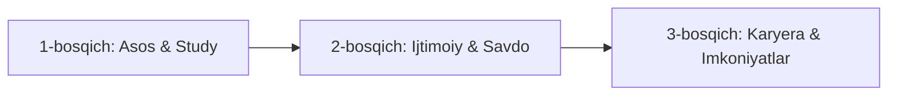

# 📋 Texnik Vazifa (TZ): "StudentHub" Yagona Raqamli Platformasi (MVP)

## 1. Loyihaning Maqsadi va Umumiy Tavsifi
**StudentHub** — talabalar uchun akademik, ijtimoiy va karyera jarayonlarini yagona ekotizimga birlashtiruvchi raqamli platforma.

Loyiha tarqoq resurslar (Telegram guruhlar, turli e'lonlar doskalari, forumlar) o‘rniga talabaga quyidagi asosiy imkoniyatlarni **bitta nuqtadan** taqdim etadi:
* 📚 **O‘quv materiallari va testlar bazasiga kirish.**
* 💼 **Ish, amaliyot va loyiha hamkorlarini topish.**
* 📖 **Talabalar o‘rtasida kitob savdosi va ayirboshlashni yo‘lga qo‘yish.**
* 🎓 **Grantlar, stipendiyalar va talabalar tadbirlaridan doimiy xabardor bo‘lish.**

---

## 2. Foydalanuvchi Rollari va Huquqlari

| Rol | Tavsif | Asosiy Huquqlar |
| :--- | :--- | :--- |
| **Mehmon (Guest)** | Tizimdan ro‘yxatdan o‘tmagan tashrif buyuruvchi | Faqat ochiq e'lonlar, tadbirlar va umumiy materiallar ro‘yxatini ko‘ra oladi. Yuklab olish, izoh qoldirish yoki e'lon berish imkoni yo‘q. |
| **Talaba (User)** | Ro‘yxatdan o‘tgan asosiy foydalanuvchi | Barcha bo‘limlardan to‘liq foydalanish, material yuklash, e'lon berish, jamoa qidirish va izoh yozish huquqiga ega. |
| **Ish beruvchi / Tashkilot (Employer/Partner)** | Hamkor kompaniya yoki tashkilot vakili | "Jobs" va "Scholarships" bo‘limlariga vakansiyalar hamda amaliyot dasturlarini joylash huquqiga ega. |
| **Moderator / Admin** | Tizim ma'muri va nazoratchisi | Materiallar, vakansiyalar, e'lonlar va izohlarni tekshirish, bloklash, toifalarni boshqarish va foydalanuvchilar ustidan nazorat o‘rnatish huquqiga ega. |

---

## 3. Asosiy Modullar va Funksional Talablar

### 3.1. 🔐 Autentifikatsiya va Profil Moduli
* **Ro‘yxatdan o‘tish va kirish:** Email/parol, Google OAuth yoki Telegram orqali tezkor kirish.
* **Talaba profili:** Ism-familiya, universitet, fakultet, yo‘nalish, kurs, qiziqish sohalari, texnik/amaliy ko‘nikmalar (*skills*), ijtimoiy tarmoq havolalari (*GitHub, LinkedIn, Telegram*).
* **Universitet verifikatsiyasi (ixtiyoriy MVP uchun):** Talabalik guvohnomasi yoki `.edu` korporativ email orqali *"Tasdiqlangan talaba" (Verified)* belgisi berish.

### 3.2. 📚 Study (Akademik Resurslar)
* **Kategoriya iyerarxiyasi:** `Universitet` ➔ `Fakultet` ➔ `Fan` ➔ `Material turi` (*Ma'ruza, Slayd, Imtihon savollari, Laboratoriya ishi, Testlar*).
* **Fayl yuklash:** PDF, DOCX, PPTX, ZIP formatlarini qo‘llab-quvvatlash (*hajm chegarasi: 50 MB gacha*).
* **Reyting va sharhlar:** Har bir materialga 5 yulduzli baho qo‘yish va foydali/noto‘g‘ri ekanligi bo‘yicha izoh qoldirish.
* **Qidiruv va filter:** Fan nomi, o‘qituvchi ismi, yuklangan sana va reyting bo‘yicha filterlash.

### 3.3. 💼 Jobs (Ish va Amaliyot)
* **Filterlash:** Bandlik turi (*Full-time, Part-time, Internship, Masofaviy/Remote*), soha, ish haqi mavjudligi, talab qilinadigan kurs darajasi.
* **E'lon tafsilotlari:** Talablar, vazifalar, sharoitlar, ariza topshirish usuli (*Platforma ichida rezyume qoldirish yoki tashqi havola/Telegram*).
* **Talaba rezyumesi:** Profil ma'lumotlari asosida avtomatik PDF rezyume shakllantirish imkoniyati.

### 3.4. 📖 Books (Kitoblar Bozori / Ayirboshlash)
* **E'lon joylash:** Kitob rasmi, nomi, muallifi, nashr yili, holati (*Yangi, Yaxshi, O‘rtacha*), narxi yoki *"Boshqa kitobga almashtiriladi"* / *"Tekinga beriladi"* teglari.
* **Aloqa mexanizmi:** Sotuvchining Telegram profili yoki platforma ichidagi *"Bog‘lanish"* tugmasi.
* **Status:** *"Sotuvda"*, *"Band qilingan"*, *"Sotildi"*.

### 3.5. 🎓 Scholarships (Grantlar va Stipendiyalar)
* **Katalog:** Mahalliy va xalqaro stipendiyalar, davlat grantlari, universitet ichki chegirmalari.
* **Har bir e'londa:** Ariza topshirish muddati (*Deadline*), qamrov doirasi (*kontrakt summasi, yashash xarajatlari*), talablar ro‘yxati, rasmiy havola.
* **Deadline bildirishnomasi:** Muddati yaqinlashib qolgan grantlar bo‘yicha eslatma (*Bookmark / Sevimlilar funksiyasi orqali*).

### 3.6. 👥 Community (Hamjamiyat)
* **Mavzuli forum / Muhokamalar:** Savol-javoblar (*Q&A formatida, Upvote / Downvote mexanizmi bilan*).
* **Toifalar:** "Universitet hayoti", "IT va Dasturlash", "Chet elda ta'lim", "Yotoqxona va ijara", "Umumiy suhbat".
* **Spam filtri:** Havolalar va nomaqbul so‘zlarni avtomatik cheklash, shikoyat (*Report*) tugmasi.

### 3.7. 📅 Events (Tadbirlar)
* **Tadbir turlari:** Xakatonlar, seminarlar, ochiq eshiklar kuni, sport musobaqalari, mehmon ma'ruzalari.
* **Taqvim ko‘rinishi (Calendar View):** Sanalar bo‘yicha tartiblangan jadval va *"Google Calendar'ga qo‘shish"* funksiyasi.
* **Joylashuv:** Online (*Zoom / YouTube havolasi*) yoki Offline (*Manzil va lokatsiya xaritasi*).

### 3.8. 🤝 Team Up (Hamkor Qidirish)
* **Loyiha kartochkasi:** Loyiha nomi, qisqacha mazmuni, kerakli rollar (*masalan: Frontend dasturchi, Dizayner, Kopirayter, SMM*).
* **Hamkorlik arizasi:** Loyihaga qiziqqan talabaning bir tugma orqali o‘z profilini havola qilgan holda qisqa *"Nega men?"* motivatsion xabarini yuborishi.

---

## 4. Qidiruv va Bildirishnomalar Tizimi
* **Global qidiruv:** Bosh sahifada yagona qidiruv satri orqali barcha bo‘limlar (*Materiallar, Vakansiyalar, Kitoblar, Odamlar*) bo‘yicha tezkor natijalar (*PostgreSQL Full-text Search yoki Elasticsearch*).
* **Bildirishnomalar (Notifications):**
  - Sayt ichidagi qo‘ng‘iroqcha (*In-app*).
  - Muhim hodisalar (*ariza qabul qilinishi, xabar kelishi, muddat eslatmalari*) bo‘yicha **Telegram Bot** integratsiyasi orqali tezkor push-xabarlar.

---

## 5. Ruxsatlar va Moderatsiya Tizimi

| Rol | Ko‘rish | Post / Material yuklash | O‘chirish / Tahrirlash | Moderatsiya |
| :--- | :---: | :---: | :---: | :---: |
| **Mehmon** | Faqat ochiq sahifalar | ❌ | ❌ | ❌ |
| **Talaba** | Barcha bo‘limlar | ✅ *(Pre-moderatsiya yoki post-moderatsiya)* | Faqat o‘zining postlari | Faqat Report yuborish |
| **Ish beruvchi** | Vakansiyalar, Rezyumelar | ✅ *(Faqat Jobs va Scholarships)* | Faqat o‘zining postlari | ❌ |
| **Admin** | To‘liq tizim | ✅ | Barcha postlarni | To‘liq huquq *(tasdiqlash / bloklash)* |

---

## 6. Nofunksional Talablar

### 6.1. Yuklama va Unumdorlik
* API javob qaytarish vaqti 95% so‘rovlar uchun **< 200 ms**.
* Statik fayllar (PDF, rasmlar) CDN orqali tezkor keshlanishi va yuklanishi shart.

### 6.2. Xavfsizlik
* Barcha ulanishlar **HTTPS (TLS 1.3)** orqali himoyalanadi.
* Foydalanuvchi parollari **Argon2** yoki **Bcrypt** yordamida xavfsiz heshlanadi.
* API so‘rovlari uchun **JWT** (*Access + Refresh tokenlar*) va **Rate Limiting** (*DDoS va spamdan himoya*).
* Yuklanadigan fayllar MIME-type tekshiruvidan o‘tishi va virus/zararli skriptlardan xoli bo‘lishi shart.

### 6.3. Moslashuvchanlik (Responsiveness)
* Mobil qurilmalar (Smartfon, planshet) brauzerlariga 100% to‘liq moslashgan bo‘lishi (**Mobile-first** yondashuvi).

---

## 7. Tavsiya Etiladigan Texnologik Stek (Arxitektura)

* **Frontend:** Next.js (React) + Tailwind CSS + shadcn/ui (*SEO, tez yuklanish va qulay komponentlar uchun*).
* **Backend:** Go (Golang) — yuqori tezlik, past resurs sarfi va modulli arxitekturaga qulayligi uchun (*yoki Node.js/FastAPI*).
* **Ma'lumotlar bazasi:** PostgreSQL (*relatsion ma'lumotlar, tranzaksiyalar va Full-text search uchun*).
* **Kesh va Navbatlar:** Redis (*sessiyalar, tez-tez o‘qiladigan ma'lumotlarni keshlash va bildirishnomalar navbati*).
* **Fayllar xotirasi (Storage):** AWS S3 yoki Cloudflare R2 / MinIO (*arzon, barqaror va S3-mos saqlash*).

---

## 8. MVP (Minimum Viable Product) Ishga Tushirish Bosqichlari

1. **1-bosqich (Asos va Study):**
   - Autentifikatsiya (Email, Google, Telegram).
   - Foydalanuvchi profili.
   - O‘quv materiallari bazasi (Study).
   - Global qidiruv.
2. **2-bosqich (Ijtimoiy & Savdo):**
   - Kitoblar bozori (Books).
   - Jamoa yig‘ish (Team Up).
   - Telegram bot orqali bildirishnoma integratsiyasi.
3. **3-bosqich (Karyera & Imkoniyatlar):**
   - Vakansiyalar va amaliyotlar (Jobs).
   - Grantlar va stipendiyalar (Scholarships).
   - Tadbirlar (Events).
   - Moderator va Admin boshqaruv paneli (Dashboard).
